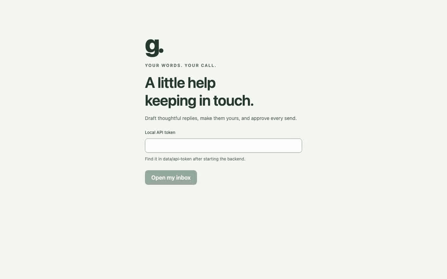
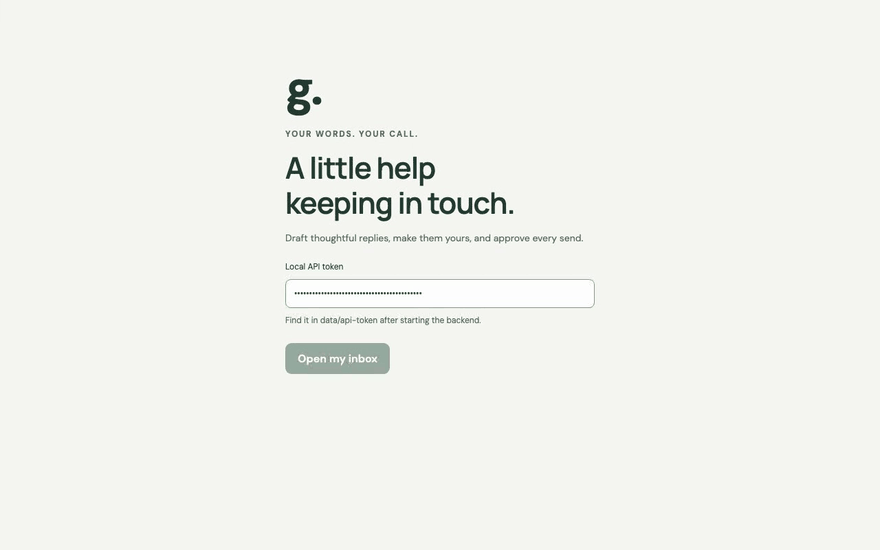

# Ghost Texter

**Catch up on your iMessages and answer them in your own voice, without anything ever sending by accident.**

Ghost Texter is a small app that runs entirely on your Mac. It finds the unread messages from people you pick, summarizes each conversation, and drafts a reply that sounds like you, using an AI model running on your own computer. You read it, edit it, and decide. **Nothing is sent until you approve the exact text.**



*The recordings use the built-in demo chats, which are made up. In demo mode the draft is a plain placeholder (no AI model is connected) and the confirmation dialog is where the demo stops, since demo mode never sends. In the inbox recording, the dialog's button was relabeled "Confirm & send" to match the live app, where it reads that; in demo mode it reads "Confirm simulated send".*

## The problem

Opening your messaging apps means walking into everything at once: group chats, old threads, notifications, and everyone you have ever talked to. The few messages that actually need an answer from you get buried in all of that, and the whole thing ends up feeling overwhelming.

I wanted one quiet place that shows only my immediate actionables: the messages I have not replied to yet, gathered together and nothing else. Ghost Texter is that space, instead of a view of everything with everyone, ever.

I also did not want to build an auto-reply tool. A bot answering your friends for you costs you something real: the replies stop being yours. So Ghost Texter keeps a human in the loop. It drafts a reply in your voice, but you read it, edit it in your own words, and approve it before anything goes out. **Nothing is sent until you approve the exact text.** The tool takes the busywork off your plate, and you are still the one talking to your friends.

What Ghost Texter does about it:

- **Less noise, more focus.** One inbox of only the unread chats from people you pick, so you can see what needs a reply and ignore the rest.
- **A refresher, not a reread.** A short summary and the latest 50 messages sit next to the reply box.
- **A first draft in your voice.** You set a default style, then add examples for individual people. Replies to your brother can be short and full of banter, while replies to a coworker stay polite. You can edit any draft or ask for a new one.
- **You stay in control.** Every send needs your approval of the exact saved text, and the app is built so the AI cannot send on its own.
- **Private by design.** The model runs on your Mac, your messages are read only from the contacts you add, and the app is not meant to be reachable from the network.

## How it works

1. **Add people.** On the **People** tab, add the contacts the app may read, as a name and a full phone number (such as `+14155550123`). It reads no one else.
2. **Open your inbox.** It lists unread chats from those people. Reading never marks a message as read.
3. **Open a chat.** You see a short summary, the earlier messages in a fold, the unread messages, and an always-there **Your reply** box.
4. **Get a draft.** Type your own reply, or press **Draft a reply** and edit what comes back. Your text is saved automatically, so you can leave and come back. Pressing **Draft a reply** again gives you a different version, because the app remembers the drafts you threw away.
5. **Send.** **Send** opens a confirmation showing exactly who it goes to and the exact text. Only that dialog's confirm button sends.



### What keeps sending safe

These rules are enforced in the code and covered by tests:

- A real send needs your approval of one saved version of the reply, to one recipient, with the conversation as it stood when you approved. If you edit the text or new messages arrive, the old approval no longer counts.
- The AI model writes text only. It has no tools, no access to the messaging connector and no way to send.
- The approval is written to disk before anything is sent. If the outcome of a send is unclear (a crash, a timeout), the app never retries by itself. It checks Messages for the message, then asks you.
- Demo mode never sends at all, so you can try everything without risk.
- Message text is never written to logs, and your data stays in a local `data/` folder that is not part of the repository.

The full rules are in [docs/APPROVAL_CONTRACT.md](docs/APPROVAL_CONTRACT.md).

## Quick start (demo mode)

Demo mode uses four made-up chats (Alex, Maya, Jordan and Priya) and needs no Messages access. It is the best way to try the app.

You need Python 3.10 or newer, [uv](https://docs.astral.sh/uv/) and Node 22.

```sh
git clone https://github.com/HariniAru/ghost-texter.git
cd ghost-texter
cp .env.example .env
uv sync
cd frontend && npm ci && npm run build && cd ..
uv run uvicorn ghost.main:create_app --factory --host 127.0.0.1 --port 8001
```

Then open <http://127.0.0.1:8001>. The login screen asks for a token that the app creates the first time it starts. Print it with:

```sh
cat data/api-token
```

Paste it in, and you are in. Press **Send** on a draft: in demo mode it explains that nothing is sent and leaves the chat in your inbox, so you can try again.

Without an AI model, **Draft a reply** fills in a plain placeholder and the summary is a short excerpt of the chat. To get real drafts, connect a model as described next.

## Connect an AI model

Ghost Texter talks to a model that runs **on your own computer** through [Ollama](https://ollama.com), an app that downloads and runs open models locally. Nothing leaves your Mac.

1. Install Ollama and start it. The desktop app starts it for you, or run `ollama serve`.
2. Download a model. The default is a small, fast one:

   ```sh
   ollama pull qwen3:4b
   ```

3. Turn it on in `.env`:

   ```dotenv
   GHOST_LLM=true
   GHOST_MODEL=qwen3:4b
   GHOST_OLLAMA_URL=http://127.0.0.1:11434
   ```

4. Check it works. This uses made-up messages only and never touches Messages:

   ```sh
   uv run python -m ghost.check_ai
   ```

5. Restart the app.

To use a different model, run `ollama pull <name>` for any model Ollama offers and put that name in `GHOST_MODEL`. Bigger models follow your voice rules more reliably but are slower. A 4-billion-parameter model such as `qwen3:4b` runs on most recent Macs, though it will sometimes ignore a strict rule (like "reply with only one word").

**A hosted model with an API key is not supported.** That is a deliberate choice. The app refuses any model address that is not on your own machine (`localhost`), so your conversations are never sent to a server. Details are in [docs/OLLAMA.md](docs/OLLAMA.md) and [docs/PRIVACY.md](docs/PRIVACY.md).

## Use it with your real iMessages

This part needs a Mac that is signed in to Messages. It reads and sends through a connector, [mac_messages_mcp](https://github.com/carterlasalle/mac_messages_mcp), which the app runs for you.

1. Give the Terminal app that launches the backend **Full Disk Access** (System Settings, then Privacy & Security), and restart it.
2. In `.env`, set `GHOST_MODE=imessage` and restart the app.
3. Add your people on the **People** tab. Sending stays off at this point (`GHOST_SEND_ENABLED=false`), so you can read, summarize and draft safely.
4. When you are happy with the drafts, set `GHOST_SEND_ENABLED=true` and restart. The send button now reads **Confirm & send** and sends for real, one approved message at a time.

Walk through your first real send with [docs/FIRST_SEND.md](docs/FIRST_SEND.md). The full setup and troubleshooting notes are in [docs/SETUP.md](docs/SETUP.md). Only direct chats are supported. Group chats and attachments are not.

## Using the app

- **Reply box.** It is always on screen for an open chat. It saves about a second after you stop typing.
- **Draft a reply.** Fills the box with a draft. If you already typed something, it asks before replacing it. **Undo** brings your text back.
- **Keyboard.** `Cmd+Enter` (or `Ctrl+Enter`) in the box opens the send confirmation but never sends. `Cmd+Shift+Enter` drafts a reply.
- **Customize your voice.** On the **People** tab, the **Default voice** card sets your general style and example replies. A person's card adds examples for just that person, which replace the default examples for them. **Suggest examples from this chat** finds replies you wrote in that chat for you to review. Nothing is learned or saved without you approving it.
- **Automatic drafts.** In **Options**, you can have the app prepare drafts for unread chats in the background. Drafts are still only drafts: they are never sent automatically.
- **New messages after a draft.** The chat shows a warning, and **Use latest messages** keeps your text but approves it against the new messages.
- **Interrupted sends.** If a send fails partway, the app checks Messages for about 30 seconds. If the message is not there, you choose **Try again** or **Discard draft**.

## The stack

| Piece | What it does |
| --- | --- |
| [Python](https://www.python.org) and [FastAPI](https://fastapi.tiangolo.com) | The local API: reading chats, saving drafts, checking approvals, sending |
| [LangGraph](https://www.langchain.com/langgraph) | The drafting workflow: draft the reply, loop if it repeats one you rejected, then pause for a human review |
| [React](https://react.dev), TypeScript and [Vite](https://vite.dev) | The dashboard you use in the browser |
| [SQLite](https://www.sqlite.org) | Local storage for drafts, approval records, your voice settings and workflow checkpoints |
| [Ollama](https://ollama.com) | Runs the AI model on your own computer (`qwen3:4b` by default) |
| [Mac Messages MCP](https://github.com/carterlasalle/mac_messages_mcp) | The connector that reads and sends iMessages, launched and controlled by the backend |
| [pytest](https://pytest.org), [Vitest](https://vitest.dev) and [Ruff](https://docs.astral.sh/ruff/) | Tests and linting |
| [Playwright](https://playwright.dev) | A development tool, not part of the app. It drives the demo in a real browser, clicking and typing the way a person would, so the recordings above show the actual interface rather than mock-ups. It also doubles as a way to check that a UI flow still works after a change. It is not a dependency of the app and is not needed to run it. |

There is no cloud service, database server, or account anywhere in the app's stack. The design is explained in [docs/ARCHITECTURE.md](docs/ARCHITECTURE.md).

## AI skills used to build it

The project was built with assistance from [Claude Code](https://claude.com/claude-code), used as a coding helper alongside my own design and decisions. A *skill* is a folder of instructions that teaches the assistant to do one kind of job well. Four are used here and live in [.claude/skills](.claude/skills):

- **[Impeccable](https://github.com/pbakaus/impeccable)** (by Paul Bakaus, Apache-2.0) is a design skill. It guides the interface work (layout, type, color, spacing) and can critique a screen against usability heuristics, which is where the score below comes from. It also ships a scanner that flags common design mistakes.
- **approval-safety-check** is written for this project. Before any change to drafting, approval or sending counts as done, it audits the change against a 25-point checklist (for example, "the only code that sends is the approve endpoint") and reports each point as pass or fail.
- **verify-demo** is also written for this project. It starts a throwaway server on made-up data and walks the app through its main flow, so a change can be checked in the running app without touching real messages.
- **caveman** (a third-party skill, Apache-2.0) makes the assistant's answers short and plain. The same style is used for the instructions sent to the AI model, which keeps its prompts small and fast.

`AGENTS.md` and `CLAUDE.md` hold the project's rules for the assistant, including the safety rules above.

## By the numbers

- **196 automated tests** (121 backend, 75 frontend), all passing. They use made-up messages and a fake connector, so no test can reach Messages.
- **One place that sends.** The only call that sends a message is inside the approve endpoint, and the safety checklist has 25 rules.
- **39/40 on the usability review**, up from 27/40 at the first review (explained below).
- **A fast local draft.** On a development Mac with `qwen3:4b` and a 50-message chat, a draft takes about 2 seconds once the summary has run, and a redraft about 1.5 seconds. The summary takes about 8 seconds and runs in the background when you open a chat.
- **Reliable regeneration.** In 30 simulated clicks of **Draft a reply** on the real local model, none failed. When the model repeats a draft you rejected, the app retries with a higher temperature, up to 3 times, before giving up.
- **A small dashboard.** The built page is about 261 kB of JavaScript (81 kB compressed). Fonts are bundled, with no outside requests.

### How the 39/40 usability score works

The score comes from [Nielsen's 10 usability heuristics](https://www.nngroup.com/articles/ten-usability-heuristics/), a standard checklist for judging how easy an interface is to use. The Impeccable skill reviews the screen against each one and gives it a score from 0 to 4:

| Score | Meaning |
| --- | --- |
| 4 | Excellent |
| 3 | Good, with minor gaps |
| 2 | Partial, with major gaps |
| 1 | Poor |
| 0 | Missing |

Ten heuristics at up to 4 points each makes **40**, and 36 or more counts as "Excellent". The ten are: visibility of system status, match with the real world, user control and freedom, consistency and standards, error prevention, recognition over recall, flexibility and efficiency, minimalist design, error recovery, and help and documentation.

The latest review of the inbox scored **39/40**: 4 on nine heuristics and 3 on user control, because removing a contact has no undo. The first review scored 27/40 ("Acceptable"), with weak spots in how visible the chats that need you were, in keyboard shortcuts, and in small print crowding the page. Eleven rounds of review and fixes got it to 39. All eleven reports are in [.impeccable/critique](.impeccable/critique).

**What this is and is not.** These are reviews run by an AI skill inside Claude Code, from the code and a rendered page. They are not a study with real users, and a review by a person might score differently.

## Project layout

```
backend/ghost/    FastAPI app, drafting workflow, storage, voice settings, connectors, dev scripts
backend/tests/    Backend tests
frontend/src/     The React dashboard and its tests
docs/             Architecture, API, approval rules, setup, privacy and more
.claude/skills/   The AI skills described above
```

Two small developer scripts are included. `uv run python -m ghost.check_ai` tests the model on made-up messages. `uv run python -m ghost.inspect_chat` prints the latest unread message of one allowed chat in your terminal, which shows real message text, so do not share its output.

To work on the code, see [docs/DEVELOPMENT.md](docs/DEVELOPMENT.md) and [AGENTS.md](AGENTS.md). To check everything:

```sh
uv run pytest
uv run ruff check backend
cd frontend && npm test && npm run build
```

## Limits to know about

- It works with direct iMessage chats on a Mac. It does not handle group chats, attachments or other messaging apps.
- It is a single-user local tool. Run one copy, and do not expose it to a network.
- A small local model can write a weak draft or miss a style rule. That is why every reply is reviewed before it goes out.
- Messages is read through an unofficial connector, so a future macOS update could break it.

More in [docs](docs): [the product flow](docs/PROJECT_FLOW.md), [voice personalization](docs/VOICE_PERSONALIZATION.md), [API](docs/API.md) and [remaining work](docs/PROJECT_PLAN.md).
