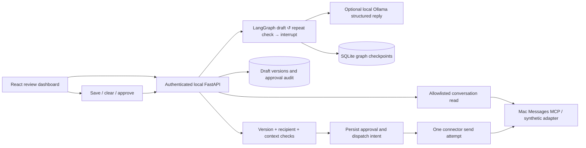

# Architecture

The MVP uses FastAPI, LangGraph, React/TypeScript/Vite, local SQLite, Ollama, and a backend-controlled Mac Messages MCP adapter. [PROJECT_FLOW.md](PROJECT_FLOW.md) defines the minimal product scope; [PROJECT_PLAN.md](PROJECT_PLAN.md) records remaining gaps.

The graph generates a draft and pauses with `interrupt`. If the draft repeats one the user rejected for the same messages, a conditional edge sends it back to the draft node, up to 3 times, before the request fails. A durable SQLite checkpointer preserves the review pause across restarts. A graph resume records the decision, including the approved edited text. Dispatch is deliberately outside the graph so graph replay cannot resend messages.

The domain store is the authority for editable text, integer versions, statuses, and audit events. Initial graph text remains the original proposal; approval includes the latest saved text from the domain store. A global asynchronous lock serializes mutation routes within the single supported API process. Database commits happen before external side effects.

SQLite is chosen for a usable local MVP. Two database files separate graph checkpoints from domain records. They are not a distributed transaction; failures after dispatch intent conservatively leave uncertain outcomes. No database server, ORM, or migration framework is needed for the local MVP. Multi-process deployment is outside its scope.

A common `Messenger` protocol has `unread`, `read`, and `send`. Demo mode supplies deterministic synthetic history; live mode invokes only fixed MCP tool names with backend-selected arguments. No tool is exposed to the LLM. The unread inbox checks only configured recipients using exact chat scope with unread_only=true. It returns previews and counts capped at 50, with an explicit cap flag. Selecting a conversation fetches its latest 50 messages and generates a short structured AI summary, or a labeled extractive preview when AI is disabled. Summaries are cached in memory for unchanged context, one entry per recipient. Drafts are created manually or through separately enabled automatic preparation; saved drafts remain in Draft history. No schema migration is needed. The dashboard refreshes draft statuses every 10 seconds. An opt-in browser timer checks the existing read-only inbox endpoint every 30 seconds; it defaults to off on login/reload. Requests do not overlap, timer ticks skip busy actions/send review, and logout/unmount aborts the request and rejects late responses. Manual and automatic inbox refresh update only the list, preserving selected context/summary and unsaved edits. They do not generate drafts, call the model, mark messages read, or send. Connection errors retain the last successful list and timestamp. There is no server-side background worker.

The MCP launcher is pinned to official commit 8eae89d9d9eae97333f4401ef47393d5e35f58ab. Each session checks its advertised tool arguments; unsupported unread/date/pagination parameters produce an actionable error. Upstream stderr is suppressed because it may contain recipient identifiers. Timestamped transcript separators escaped by the upstream untrusted-output wrapper are restored for display/counting; arbitrary escapes remain intact and tool output remains untrusted data.

Exact-address lookup now runs through `ghost/mcp_server.py` inside the official MCP environment. It replaces the pinned upstream unordered chat lookup with latest-message activity ordering among exact matches. A live diagnosis confirmed an old 2019 thread was selected instead of a current thread with unread messages. This wrapper neither expands recipient scope nor grants the LLM tools; existing context fingerprints invalidate drafts from a previously selected thread.

The Ollama provider uses the local native /api/chat endpoint with JSON schema and Pydantic validation, no credentials, no tools, and no cloud fallback. The same LangGraph pause and approval service remain in use. Its explicit prompt-size and generation limits bound local resource use.

Automatic preparation is a browser queue, off on every connection/reload. It handles one unread candidate at a time, pauses scheduling during other actions, unsaved edits, inbox loading, or send confirmation, and adds new saved drafts without selecting them or replacing editor text. It remembers attempted recipient/preview/count combinations for the session. The backend rechecks unread status and the exact context fingerprint, preserves existing reviews, skips latest outgoing messages, and deduplicates previously reviewed snapshots across sessions. Errors pause the queue until explicit retry. Turning the toggle off stops scheduling; an already running request may finish and save a draft. Locking the workspace aborts browser requests and ignores late results, but backend work may already have persisted a draft. This is not a durable monitoring service, and preview/count signatures may miss changes; manual drafting remains available.

## Target changes, not yet implemented

Automatic preparation currently has one workspace-wide toggle; the agreed target is an independently saved opt-in for each exact-address chat. Rejection retains a terminal draft. Manual drafting passes up to 5 rejected drafts for the same fingerprint into the prompt as untrusted data, and refuses an output that repeats one. The per-chat opt-in should be added within the existing services and graph, without new agents or storage infrastructure. Local SQLite remains necessary for saved drafts and durable approval state; it is not a full archive of Messages.

Voice personalization extends the existing JSON profile in SQLite without a schema migration. `voice.py` validates global and exact-recipient profiles and resolves a bounded style/example input before graph invocation. Only the chosen recipient's examples (or global fallback) enter the graph; all recipient profiles are never passed to the model. The authenticated suggestions endpoint reads the current allowlisted chat window and extracts pairs deterministically, without a model or profile mutation. Review and explicit profile save are separate steps. This never runs during refresh or dispatch. See [VOICE_PERSONALIZATION.md](VOICE_PERSONALIZATION.md).
